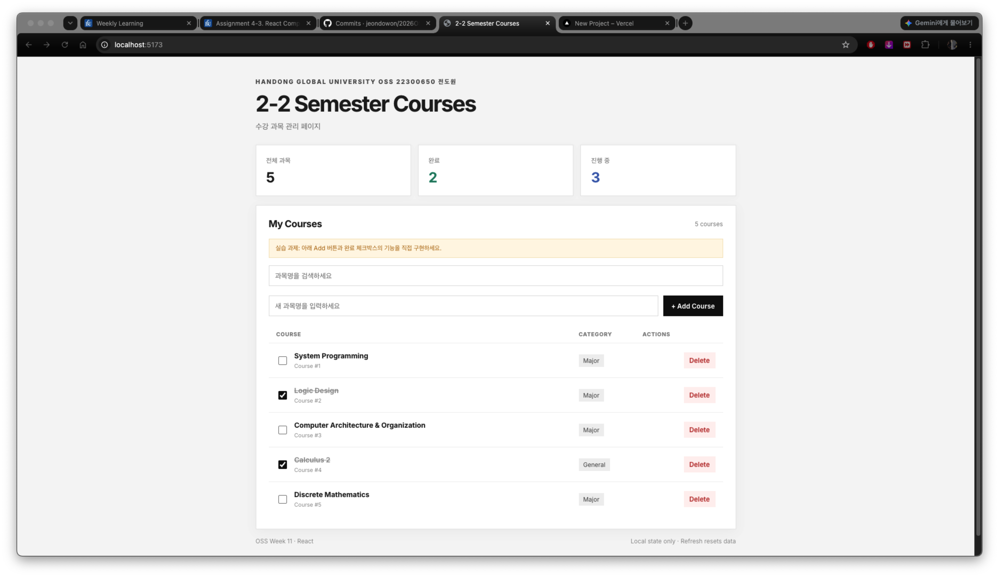

# 오픈소스 스튜디오 01분반

22300650 / 전도원

## Assignment 11. React Component & State

## Project Information

프로젝트 소개: 수강 과목을 관리하는 React 웹 페이지이다.
Course Manager Sample Project를 가져와서 데이터와 디자인을 바꾸고, 과목 등록, 완료 상태 변경, 검색 기능을 추가했다.

주요 기능:

1. 과목 목록 조회 및 삭제
2. 과목 등록
3. 과목 완료/미완료 변경
4. 과목명 검색

원본 Sample Project URL: https://github.com/2026-2-OSS/week11_sample_project

## Installation

```bash
git clone https://github.com/2026-2-OSS/assign11-c01-22300650.git
cd assign11-c01-22300650
npm install
npm run dev
```

npm run dev 실행 후 터미널에 나오는 Local URL(http://localhost:5173)에 접속한다.

실행 화면:


## Source Code Exploration

### Project Structure

주요 파일 3개:

1. CourseList.jsx: courses state의 부모 컴포넌트이다. 삭제, 등록, 완료 변경, 검색 함수가 포함되어 있고, 목록도 이 파일에서 만든다.
2. CourseItem.jsx: 과목 목록에서 한 줄을 그린다.
3. courses.js: 과목 배열(initialCourses)이 있다.

### Component & Props

CourseList가 courses.map()으로 과목마다 CourseItem을 하나씩 만들면서 course, onDelete, onToggle을 props로 넘긴다. 자식은 부모의 state를 직접 바꿀 수 없기 때문에 버튼을 누르면 props로 받은 함수를 호출해서 부모가 state를 바꾸게 한다.

### State & Event

CourseList는 useState(initialCourses)로 과목 목록을 관리한다. Delete 버튼을 누르면 onDelete(course.id)가 호출되고, handleDelete가 filter()로 해당 id를 제외한 새로운 배열을 setCourses()에 넘긴다. 이걸 React가 확인후 화면을 다시 그리면 해당 과목이 화면에서 사라진다.

주요 코드 1:

```jsx
const [courses, setCourses] = useState(initialCourses);

function handleDelete(id) {
  if (!window.confirm("이 과목을 삭제하시겠습니까?")) return;
  setCourses((previous) => previous.filter((course) => course.id !== id));
}
```

설명: useState(initialCourses)로 courses 배열과 이를 바꾸는 setCourses 함수를 만든다. confirm()에서 취소하면 return으로 아무것도 하지 않고 종료한다. 새 배열을 만들어야 React가 변경을 확인하기 때문에, 확인을 누르면 filter()를 사용해서 id가 다른 과목들로만 이루어진 새 배열을 만들고 setCourses()가 state를 새 배열로 바꾼다.

주요 코드 2:

```jsx
<input
  className="check"
  type="checkbox"
  checked={course.completed}
  onChange={() => onToggle(course.id)}
/>
<div className={`course-title ${course.completed ? "done" : ""}`}>
  {course.name}
</div>
```

설명: 체크박스의 checked는 props로 받은 course.completed 값에 따라 상태가 바뀐다. 체크박스를 누르면 onToggle(course.id)가 실행되어 부모가 completed 상태를 변경하고, 완료된 과목에는 done 클래스가 추가되어 스타일이 달라진다.

## Customizing

수정한 파일: index.html(탭 제목), src/App.jsx(제목, 설명, 태그 삭제), src/data/courses.js(과목 데이터), src/App.css(스타일)

초기 과목 데이터를 수정하였고, 제목과 설명, 탭 제목도 변경했다. STUDENT STARTER 태그는 삭제했고 css 전체를 흑백 테마로 변경했다. border radius도 삭제하여 둥근 느낌에서 각진 느낌으로 수정했다.

## Feature Extension

1. 과목 추가 기능

```jsx
function handleAdd(event) {
  event.preventDefault();

  if (newName.trim() === "") {
    alert("과목명을 입력하세요.");
    return;
  }

  const newCourse = {
    id: Date.now(),
    name: newName.trim(),
    category: "Major",
    completed: false,
  };

  setCourses((previous) => [...previous, newCourse]);
  setNewName("");
}
```

동작 결과: trim()으로 공백만 입력한 경우 예외처리하여 등록되지 않게 했다. 새 과목은 [...previous, newCourse]로 기존 배열을 복사한 뒤 끝에 추가하여 화면에 반영되도록 했고, 등록 후에는 입력창이 setNewName("")으로 비워진다. id는 중간 과목을 삭제한 뒤에 추가해도 겹치지 않도록 Date.now()를 사용했다.

2. 체크박스 완료/미완료 상태 변경

```jsx
function handleToggle(id) {
  setCourses((previous) =>
    previous.map((course) => {
      if (course.id === id) {
        return { ...course, completed: !course.completed };
      }
      return course;
    }),
  );
}
```

동작 결과: map()으로 id가 같은 과목만 spread(...)로 복사한 새로운 객체에서 completed를 반대로 바꾼다.

## Deployment

GitHub URL: https://github.com/2026-2-OSS/assign11-c01-22300650

Vercel URL: https://2026-oss-a4-3.vercel.app/

## Weekly Review

새롭게 배운 내용:

1. props는 부모에서 자식으로만 내려가기 때문에, 자식이 부모의 state를 바꾸려면 부모의 함수를 props로 받아서 호출해야 한다는 것을 배웠다.
2. state 배열은 직접 수정하면 안 되고, map(), filter(), spread(...)로 새 배열을 만들어 set 함수에 넘겨야 화면이 바뀐다는 것을 배웠다.
3. id를 지정할 때 Date.now()를 사용하면 겹치는 일을 줄일 수 있다는 것을 배웠다.

어려웠던 점과 해결 방법: 과목을 등록할 때 id를 어떻게 정할지가 어려웠다. courses.length + 1로 하면 중간 과목을 삭제한 뒤 추가할 때 id가 겹쳤다. ai에게 해결방법을 추천받아 Date.now()를 id로 사용할 수 있다는 것을 알았다. 또한 전체 테마를 흑백으로 바꾸려고 했는데 바꿔야할 곳과 어울리는 색상코드를 하나하나 찾기 번거로워서 ai에게 색상코드를 추천받았고, 바꿔야할 부분을 하나하나 찾아서 해당 부분에 어울리는 추천받은 색상 코드를 변경하면서 어떻게 바뀌는지 확인했다.

AI 활용 내용 및 느낀 점:

도구: Claude (Claude Code)

사용목적: 설명 및 검토

AI가 도와준 것: 샘플 코드 구조 설명, 흑백 테마로 바꿀 때 사용할 색상코드 추천, id를 Date.now() 사용하라고 추천, 커밋/제출 전 검토

직접 수행한 작업: 코드 작성, 흑백 테마 CSS를 한 곳씩 확인하며 변경, 기능 구현

느낀 점: React는 예전부터 배우고 싶었는데 수업에서 배울 수 있어서 좋았다. 이미 만들어져있는 샘플 프로젝트를 내 취향대로 수정하는 작업이 즐거웠고, React를 사용해서 기능을 구현하는 것도 이전에 배웠던 JS와 비슷해서 크게 어렵지 않고 재밌었다.

본인 추정 AI 기여율(%): 20%
